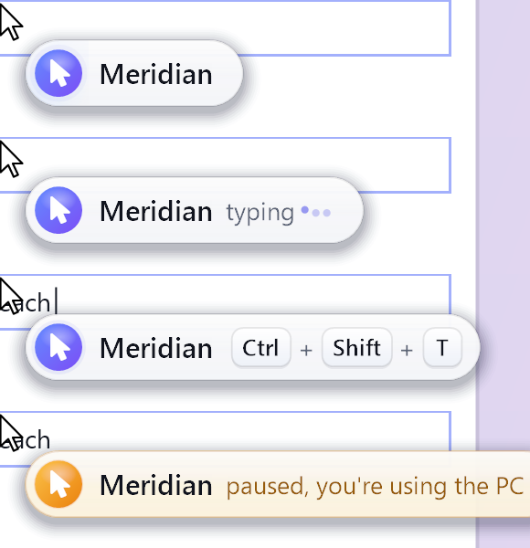

# reach

Small, fast desktop control for Windows, built for AI agents.
<br clear="left">

One ~115 KB exe. No installer, no runtime to download (it uses the .NET Framework 4.8 that ships with Windows 10/11). It runs a tiny tray server on `127.0.0.1`, and you drive it from the CLI or over MCP: screenshots, mouse, keyboard, windows, and the accessibility tree.

Output is kept short on purpose so agents spend tokens on the task, not on parsing. Every list command has `--json` when you want everything.

## Install

1. Grab `reach.exe` from [Releases](../../releases), or build it yourself (below).
2. Drop it anywhere, e.g. `C:\Tools\reach\reach.exe`, and add that folder to your PATH if you like.
3. Run `reach status`. The first command starts the tray server for you.

Want it running at logon? Put a shortcut to `reach.exe serve` in `shell:startup`.

Config, the auth token, and logs are created on first run in `%USERPROFILE%\.reach\`. Nothing is baked into the exe.

### Build from source

```powershell
powershell -ExecutionPolicy Bypass -File build.ps1
```

That's it. It calls `csc.exe` from `%WINDIR%\Microsoft.NET\Framework64\v4.0.30319` (`/target:exe /platform:x64`) on `src/Reach.cs`. No SDK, no NuGet. `reach selftest` runs quick offscreen checks of the key parser and glide math.

## CLI

Coordinates are always in the latest screenshot's pixels. Don't scale them.

```
reach open notepad                 launch it, or focus it if it's already open
reach apps                         one line per window: hwnd title [process] x,y wxh
reach apps chrome --json           filter, full detail
reach focus 0x1A2B3C               (or a title / process name)
reach displays

reach screenshot                   JPEG path + "1280x720 cursor 400,300 | 0,0 1280x720*"
reach screenshot --max 800 --quality 60
reach screenshot --region 100,100,400,300
reach zoom 100 100 400 300

reach click 640 360                also double-click, right-click, move
reach drag 100 100 400 300
reach scroll down 3
reach type hello world             real per-key events at a visible pace
reach key ctrl+shift+t             chords, win+r works too (win+l is blocked)
reach key "ctrl+c, ctrl+v"         sequences: comma or space separated
reach key shift --hold 500         hold for 500 ms
reach motion smooth|fast|instant   how input moves (default smooth)
reach click 640 360 --fast         quick motion for one command

reach ui find Save                 e12 button "Save" 913,40
reach ui inspect                   useful controls only (named or interactive)
reach ui inspect --all --json      everything, full detail
reach ui invoke e12                refs stay valid between calls
reach ui invoke Save               or just use the name
reach ui set e7 some text
reach ui read e7

reach status
reach pause | resume               hard stop from the tray icon, too
reach usage                        last few calls from the local usage log
```

A `ui find` line looks like `e12 button "Save" 913,40 disabled`, which is ref, type, name, click point, and flags. Refs are tied to the element, so the same control keeps the same ref and you can act on it later without re-reading the tree.

## MCP

The server speaks MCP over streamable HTTP at `http://127.0.0.1:7420/mcp`. Five tools: `screenshot`, `apps`, `mouse`, `keyboard`, `ui`. Requests need the bearer token from `%USERPROFILE%\.reach\token`.

**Claude Code**

```powershell
$t = Get-Content "$env:USERPROFILE\.reach\token"
claude mcp add --transport http reach http://127.0.0.1:7420/mcp --header "Authorization: Bearer $t"
```

**Cursor** (`~/.cursor/mcp.json`, with `REACH_TOKEN` set in your environment)

```json
{
  "mcpServers": {
    "reach": {
      "url": "http://127.0.0.1:7420/mcp",
      "headers": { "Authorization": "Bearer ${env:REACH_TOKEN}" }
    }
  }
}
```

## Human-like input

reach never teleports the mouse by default. It glides the real cursor along a slightly curved, eased path (about 120 steps a second, 150 to 450 ms depending on distance), lands exactly on the target, and checks it got there. Clicks have a short press and release, and drags glide too.

Typing sends real key events one character at a time, about 25 to 45 ms apart with a little jitter, so you can watch it happen. Long text speeds up so it never takes more than about 12 seconds. Chords press modifiers first, then the key, then release in reverse order, and everything gets released even if something fails.

Need speed instead? `reach motion fast` (short glides, bulk typing) or `reach motion instant` (old school teleport), or `--fast` for a single command (`fast: true` over MCP). Accuracy is the same in every mode.

If you grab the mouse in the middle of a glide, reach stops, waits until you're done, and carries on from wherever the cursor is.

## Agent pill



While an agent is acting, reach shows a frosted, light name pill right next to your real mouse cursor, so you always know who's driving. It shows the reach logo and the agent's name, animated typing dots while it types, the chord as little keycaps when it presses keys (Ctrl + Shift + T), and turns soft amber with "paused, you're using the PC" when reach is waiting for you. It sits below and to the right of the arrow so it never covers the tip, springs in, follows the cursor smoothly at 60 fps, morphs its width as the text changes, and fades out a few seconds after the agent stops. The timer stops when it's hidden, so it costs nothing at idle.

- Name comes from `--agent "Claude"`, the `REACH_AGENT` env var, an `agent` argument or `X-Reach-Agent` header, or the MCP client's name. Otherwise it's just "Agent".
- Clicks get a subtle ring around the cursor tip. `reach cursor ripple off` turns that off.
- It's click-through, never takes focus, and stays out of Alt-Tab.
- It's hidden from screen capture (including reach's own screenshots), so it never ends up in what the agent sees. Use `reach screenshot --include-overlay` if you want to capture it.
- `reach cursor off` turns it off, `--no-cursor` skips it for one command.
- `reach pill-preview --out <folder>` renders the pill animation to PNG frames offscreen (no window, nothing on screen). Handy for tweaking the look. `reach logo out.png 256` writes the logo.

## Pause on user

If you grab the mouse or start typing, reach backs off. Any command that would click, type, or move things waits until you've been idle for 2 seconds, then runs. Reads like screenshots and `ui find` don't wait.

- It watches real input only. Injected input (reach's own, or other tools') doesn't count.
- While it waits, the agent's pill turns amber and says "Paused, you're using the PC", and the tray icon changes.
- If you keep going for longer than 60 seconds, the command fails with a clear message instead of hanging forever.
- `reach pause-on-user on|off|status`, `reach pause-on-user idle 2000`, `reach pause-on-user timeout 60000` (also `userPauseIdleMs` and `userPauseTimeoutMs` in `config.json`). `--no-yield` skips the wait for one command.

### Input lock tools

If you run an input-lock tool as `inputlock.exe` (something that blocks your physical keyboard and mouse while an agent works), reach notices it and ignores the blocked input, so it won't pause itself for input that never reached the desktop. Injected input still flows, so reach keeps working while you're locked out. (The lock tool itself isn't part of this repo.)

## Security

- The server only listens on `127.0.0.1`. Nothing is reachable from the network.
- Every request except `/health` needs `Authorization: Bearer <token>`. The token is 32 random bytes generated on first run and stored in `%USERPROFILE%\.reach\token`. Treat it like a password, anyone with it can drive your desktop.
- `Win+L` is blocked so an agent can't lock you out.
- Pause from the tray icon (or `reach pause`) and nothing can act until you resume.
- Typed text isn't written to the usage log.

## Config

`%USERPROFILE%\.reach\config.json`:

| key | default | what |
| --- | --- | --- |
| `port` | 7420 | server port |
| `maxDim` | 1280 | long edge of screenshots (also the click coordinate space) |
| `agentCursor` | true | show the agent name pill |
| `cursorRipple` | true | subtle ring on clicks |
| `pauseOnUser` | true | wait while you're using the PC |
| `userPauseIdleMs` | 2000 | idle time before resuming |
| `userPauseTimeoutMs` | 60000 | give up after this long |
| `motion` | smooth | `smooth`, `fast`, or `instant` |

Set `REACH_HOME` to another folder to run a second, isolated instance with its own config, token, and port.

## License

MIT
