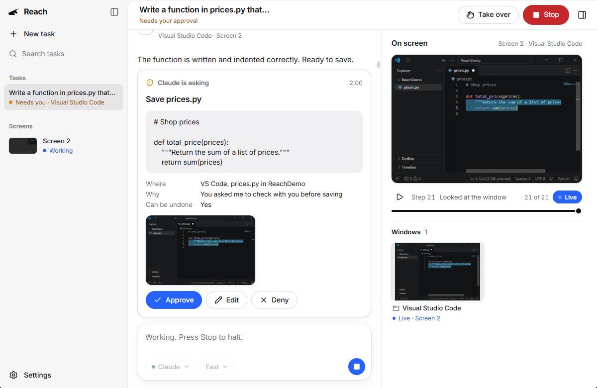
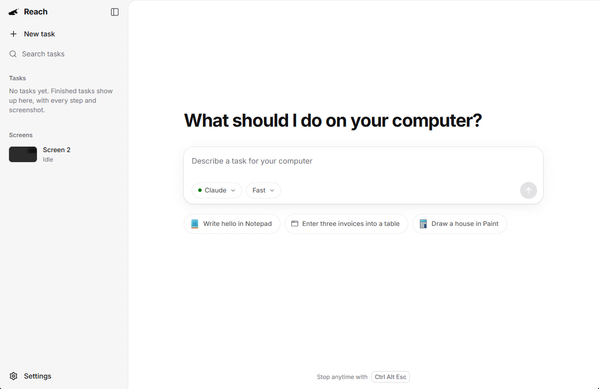
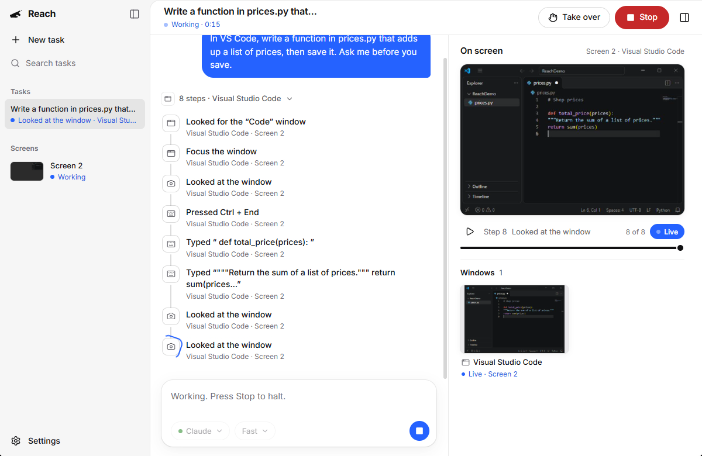
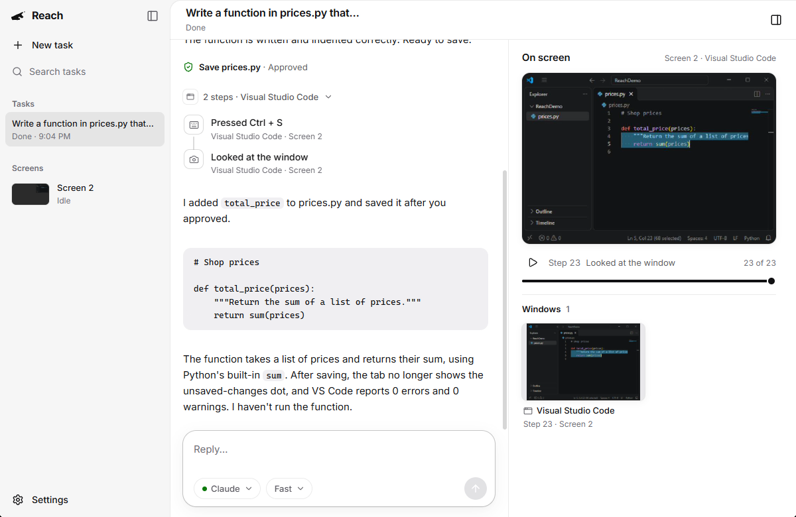
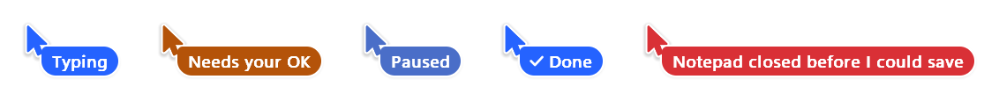
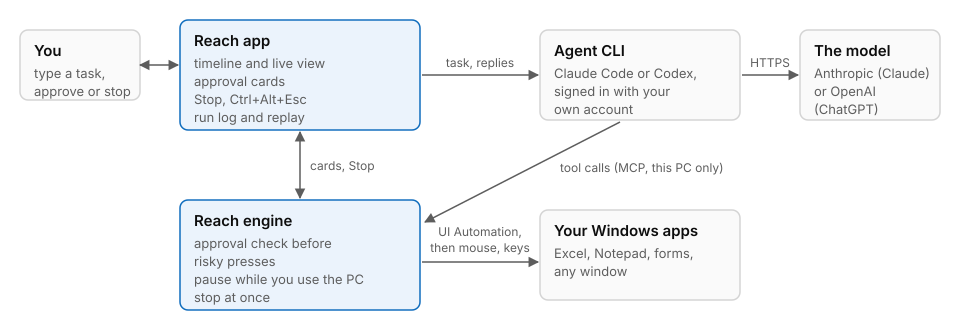

<p>
  <picture>
    <source media="(prefers-color-scheme: dark)" srcset="assets/brand/png/wordmark-dark.png">
    
  </picture>
</p>

Reach lets Claude or ChatGPT use the apps on your Windows PC for you. You watch every step and approve anything risky before it happens.

**Public beta, version 0.3.0.** It works for the tasks in [CHANGELOG.md](CHANGELOG.md), but expect rough edges. See [Known issues](#known-issues) for what hasn't been tested yet.

<picture>
  <source media="(prefers-color-scheme: dark)" srcset="docs/images/screen-approval-dark.png">
  
</picture>

*A real run with Claude, sped up: "In VS Code, write a function in prices.py that adds up a list of prices, then save it. Ask me before you save." The light run took 19 steps and about 43 seconds (shown at 1.8x); the dark run took 17 steps and about 37 seconds (shown at 1.5x). Both include the approval card and the Approve press. The agent worked in a throwaway folder, with Reach's test mode limiting it to the VS Code window. On the right, the screen panel shows the window after each step and a thumbnail of each window it used.*

## What it does

You type a task. The agent (Claude Code or Codex, signed in with your own account) works in your Windows apps through Reach. It reads their controls with UI Automation and falls back to the mouse and keyboard. Each step shows up in a timeline, with a picture of the window after it.

<table>
  <tr>
    <td width="50%">
      <picture><source media="(prefers-color-scheme: dark)" srcset="docs/images/screen-start-dark.png"></picture>
      <br><b>Start.</b> Type a task, pick Claude or ChatGPT and a Speed. Past tasks stay in the sidebar.
    </td>
    <td width="50%">
      <picture><source media="(prefers-color-scheme: dark)" srcset="docs/images/screen-working-dark.png"></picture>
      <br><b>Working.</b> Every step, in which app and on which screen. The screen panel shows the window after each step, with a thumbnail of each window used.
    </td>
  </tr>
  <tr>
    <td>
      <picture><source media="(prefers-color-scheme: dark)" srcset="docs/images/screen-approval-dark.png"></picture>
      <br><b>Approval.</b> Before it sends, posts, pays, deletes or signs in, you get a card: what, where, the exact content, why, and whether it can be undone. Approve, Edit or Deny.
    </td>
    <td>
      <picture><source media="(prefers-color-scheme: dark)" srcset="docs/images/screen-done-dark.png"></picture>
      <br><b>Done.</b> The agent says what it did and how it checked. Reply to continue, or replay the steps.
    </td>
  </tr>
</table>

Light and dark follow your Windows setting, or pick one for Reach only in Settings > Theme.

While it works, the agent's own pointer moves on your screen, separate from your mouse, with a small tag on its tail that says what it's doing. When it needs your OK, the tag opens into Approve, Edit and Deny.

<picture><source media="(prefers-color-scheme: dark)" srcset="docs/images/pill-dark-page.png"></picture>

When a new version is published on GitHub, Reach shows a card with Install, Remind me later and Skip this version. It installs only when you press Install, and only after checking the download against the release's checksums.

## Install

Download from the [Releases](https://github.com/carbongotfound/reach/releases) page:

- `Reach_<version>_x64-setup.exe`: the installer (per user, no admin needed). It installs to `%LOCALAPPDATA%\Reach` and adds Start menu and Desktop shortcuts. Uninstalling (Settings > Apps) removes the app but keeps your run history and settings in that folder; delete the folder to remove them too.
- `Reach-<version>-portable.exe`: a single exe you can run from anywhere.
- `SHA256SUMS.txt`: check a download with `Get-FileHash <file>` in PowerShell.

Tested on Windows 11. Windows 10 with the WebView2 runtime should work but hasn't been tested.

**SmartScreen.** The builds are not code-signed yet, so Windows shows "Windows protected your PC" the first time. Choose **More info**, then **Run anyway**. [docs/signing.md](docs/signing.md) explains why and the plan for signing.

## Sign in with Claude or ChatGPT

Reach has no API keys and no account of its own. It runs an agent CLI that you have already signed in to:

| Agent | Install | Sign in |
|---|---|---|
| Claude | Claude Code (`claude`) | Run `claude` in a terminal once and sign in with your Claude account. |
| ChatGPT | Codex CLI (`codex`) | Run `codex login` and sign in with your ChatGPT account. |

Pick the agent in the task box's footer. If the CLI isn't installed or isn't signed in, Reach says so and offers Retry. Your usage counts against that account's plan.

## Speed

The Speed setting in the footer controls how the mouse and keyboard move when the agent has to use them:

- **Instant**: no visible motion; the pointer jumps and text is typed in bulk.
- **Fast** (the app's default): quick, short moves.
- **Human**: curved mouse paths and natural typing, about 39 ms per key.

It changes less than you might expect. Reach prefers UI Automation (pressing a button or filling a field through its control), which doesn't move the mouse at all. In the timing tests the demo task took 26 to 30 seconds at every Speed; almost all of that was the model thinking between steps.

## Safety

- **The agent asks first.** The system prompt tells it to call an approval tool before it sends, posts, submits, pays, deletes, installs, signs in or shares. You see an approval card. No answer in 2 minutes counts as Deny.
- **Reach checks anyway.** Right before a press on a control whose name says send, submit, pay, delete, sign in and so on, the engine stops and asks, even if the agent forgot. This check runs in Reach, not in the model.
- **Stop at any time** with the Stop button or **Ctrl+Alt+Esc** from anywhere. It halts the action in progress and ends the agent.
- **It waits for you.** If you move the mouse or type, Reach pauses before its next action (a click, a key, or pressing a button or filling a field for you) until you've been idle for 2 seconds. Only looking at the screen goes on meanwhile. **Take over** holds it until you press Give back.
- **Screen text is data.** The prompt tells the agent not to follow instructions it reads on screen, and Reach warns when tool output contains phrases aimed at the agent.
- **Everything is logged.** Every run is saved with its steps, messages, approvals and screenshots, and can be replayed.

The engine check has gaps: keyboard shortcuts, unnamed or icon-only buttons, custom-drawn apps and non-English labels are not caught. [docs/safety.md](docs/safety.md) has the full table and the tests behind each claim.

## How it works

<picture>
  <source media="(prefers-color-scheme: dark)" srcset="docs/images/how-it-works-dark.svg">
  
</picture>

- The **app** (Tauri 2 and React) starts the agent CLI for each task and gives it Reach's tools through an MCP server on `127.0.0.1`, protected by a random token.
- The **engine** (`crates/reach-core`, Rust) carries out each tool call: list and focus windows, read and press controls with UI Automation, take screenshots, and move the mouse and type when there is no other way.
- `crates/reach` is the same engine as a command-line tool with a tray icon. The older C# version (0.2.x) is in the history under the `v0.2.1` tag.

## What leaves your PC

Reach itself sends nothing about you: no telemetry, no account. The app checks GitHub for a newer release after it starts and every 6 hours. That request carries no identifiers, and you can turn it off in Settings. The agent CLI sends your task, its prompt, the screenshots it takes and the text it reads from apps to Anthropic or OpenAI to be answered. Run logs, settings and screenshots stay on your PC. [docs/privacy.md](docs/privacy.md) lists exactly what goes where.

## Known issues

- Windows only. Windows blocks input into apps running as administrator; Reach checks for this and says so, but that check hasn't been tested yet.
- Each step waits for the model, so a simple task takes tens of seconds. Reach is for tasks you'd rather not do by hand, not for speed.
- The agent works on your real desktop, with your mouse. Use the PC lightly or let it pause for you.
- **ChatGPT (Codex): not tested end to end.** It's tested with a stand-in CLI and with real Codex up to sign-in, but no full task has run with a signed-in ChatGPT account. The app marks it "Not tested yet" in the agent picker.
- **English only.** The words that make Reach stop and ask (Send, Pay, Delete, Sign in and so on) are English. Buttons in other languages aren't caught by the engine guard; the agent's own approval request still applies.
- The update check and a full update (0.3.0 to a test 0.3.1) have run against a local copy of GitHub's API, not yet against a real release.
- The builds are unsigned (see above). The installer has been tested (install, start, silent uninstall) on one PC, not yet on a clean one.

## Build from source

Needs Windows, Rust (stable) and Node.js 22.

```powershell
cd app
npm ci
npm run build
cd ..
cargo build --release -p reach-app -p reach
```

That gives `target\release\reach-app.exe` (the app) and `target\release\reach.exe` (the command-line engine). For the installer, run `npx tauri build --bundles nsis` in `app`. Tests: `cargo test -p reach-core -p reach-app`. The same steps run for every pushed `v*` tag in [.github/workflows/build.yml](.github/workflows/build.yml), which makes a draft release.

## Contributing

Issues and pull requests are welcome. Please read [CONTRIBUTING.md](CONTRIBUTING.md) first; UI changes follow [docs/design.md](docs/design.md). Report security problems privately as described in [SECURITY.md](SECURITY.md).

## License

[MIT](LICENSE)

Claude is a trademark of Anthropic. ChatGPT and OpenAI are trademarks of OpenAI. Reach is not affiliated with or endorsed by either.
